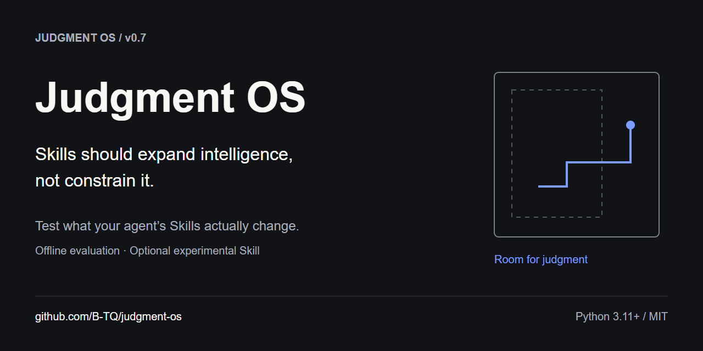
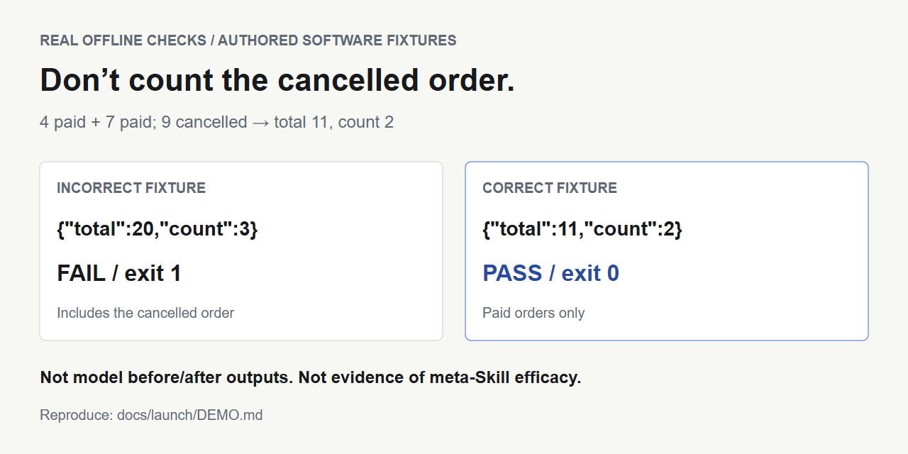
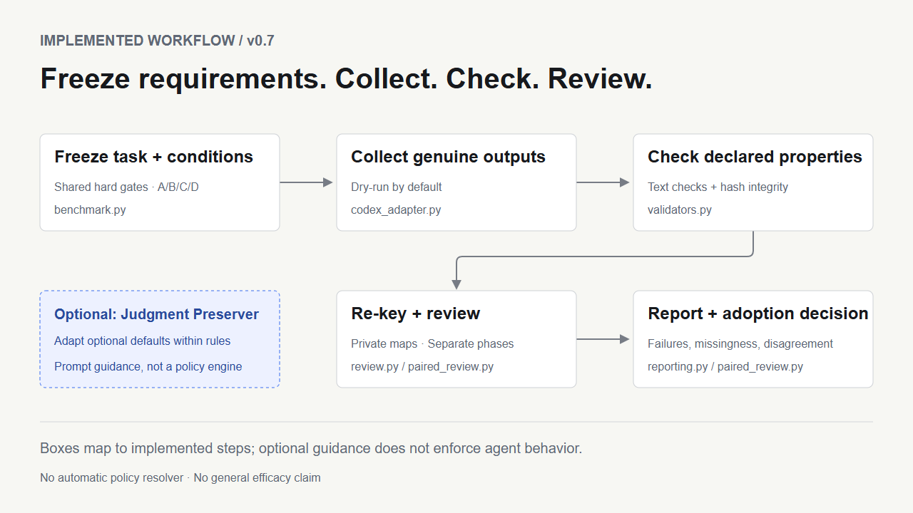

# Judgment OS

**Test what your agent's Skills actually change.**

*Your agent got more Skills. Does every default still fit the task?*

Judgment OS is an offline-first evaluation toolkit for Agent Skill and prompt developers. Compare task-only, domain guidance, an experimental meta-Skill, and a one-sentence reminder under the same requirements. Keep failures and review limitations visible.

**v0.7 · Python 3.11+ · standard-library runtime · MIT**

[中文](README.zh-CN.md) · [Download v0.7](https://github.com/B-TQ/judgment-os/releases/tag/v0.7) · [Walkthrough](docs/QUICKSTART.md) · [Commands](docs/CLI.md) · [Evidence](docs/launch/EVIDENCE.md)



## See a real check

Three orders: 4 paid, 7 paid, 9 cancelled. The required result is `{"total":11,"count":2}`. The bundled incorrect answer includes the cancelled order; the validator rejects it. The correct fixture passes.



These are **authored software fixtures, not before/after model generations**. They show the checker working, not the meta-Skill improving an agent. [Reproduce both exits](docs/launch/DEMO.md).

## Quick start: three offline commands

Download and extract the [source ZIP](https://github.com/B-TQ/judgment-os/releases/tag/v0.7), or:

```sh
git clone https://github.com/B-TQ/judgment-os.git
cd judgment-os
python judgment.py doctor
python judgment.py demo --out runs/first-demo
python judgment.py check --case Q01 --answer examples/quickstart/correct.json
```

No pip install, account or API key is needed. Use `python3` if that is your Python 3.11+ command. The demo creates **8 empty A/B/C/D slots**, checks two fixtures and makes **zero model calls**. It does not invent answers or scores. On repeats choose a fresh output directory. Read the generated `START_HERE.md` for next steps.

On Windows with Python installed, double-click [TRY_DEMO.cmd](TRY_DEMO.cmd) to run these steps with a fresh output directory automatically. On any supported OS, `python scripts/try_demo.py` offers the same offline shortcut. The launcher only runs the three commands above.

To see the intentional failure:

```sh
python judgment.py check --case Q01 --answer examples/quickstart/incorrect.json
```

Exit 1 is expected. A deterministic pass covers only the declared text properties.

## Why compare guidance?

A Skill's optional workflow or template can be a poor fit for a particular task. That is a testable possibility, not evidence that Skills generally make agents less capable. Adding another long prompt may also add no useful benefit.

Judgment OS separates the idea from the evidence: freeze common requirements, collect genuine outputs, check declared properties, re-key review packets, and report failures and disagreements. The optional **Judgment Preserver** asks the agent to preserve binding requirements while adapting genuinely optional defaults. It is prompt guidance, not an instruction-policy engine.

| Condition | Guidance |
| --- | --- |
| A | Task only |
| B | Task + domain Skill |
| C | B + full Judgment Preserver |
| D | B + one-sentence task-fit reminder |

## What v0.7 provides

- Deterministic JSON, CSV, fixed-text, heading, line and whitespace-word checks.
- Frozen cases, common hard gates, prompt hashes and seeded study preparation.
- Dry-run-first Codex collection, or genuine external answer import with declared provenance.
- Re-keyed review exports, hash-bound imports and explicit review-phase selection.
- Reports retaining missing/failed runs, gate failures and reviewer disagreement.
- Project-local optional Skill installation with preview, overwrite refusal and guarded removal.



[Implementation and non-goals](docs/architecture.md) · [Audited feature status](docs/launch/AUDIT.md)

## What the evidence says

The full meta-Skill **has not established a general advantage over a one-sentence reminder**. In the eight-case v0.6 follow-up, C versus D was **1 win / 7 ties / 0 losses**. The only win came from D exceeding a word limit by one word. The predeclared adoption threshold was not met, so the full Skill stays optional.

The initial model reviews had incidental exposure to other-chat summaries. Those reviews were preserved; a corrective projectless review phase used the same unchanged outputs and reached the same pairwise result. Both phases are reported separately. This is small-sample, model-only evidence, not independent human validation or proof of equivalence.

[English evidence and replication limits](docs/launch/EVIDENCE.md) · [Detailed original results / 中文](docs/FOLLOWUP_V06_RESULTS.md) · [Protocol](docs/STUDY_PROTOCOL_V06.md)

## Optional Skill: install, preview, remove

```sh
python judgment.py skill install --project /path/to/existing/project --dry-run
python judgment.py skill install --project /path/to/existing/project
python judgment.py skill uninstall --project /path/to/existing/project --dry-run
python judgment.py skill uninstall --project /path/to/existing/project
```

Replace the example path with an existing project; quote paths containing spaces. In a supporting Codex host, explicitly invoke `$judgment-preserver`. Existing Skills are never overwritten. Removal refuses modified or added files. The core text remains v0.2; v0.7 versions the toolkit. [Details](docs/CLI.md#managed-skill-installation).

## Compatibility and limits

| Environment | Verified scope |
| --- | --- |
| Python 3.11 / 3.14, Windows / Linux | Offline CI matrix; see the actual [Actions results](https://github.com/B-TQ/judgment-os/actions/workflows/ci.yml) |
| Codex native adapter | Local staging/tests and prior recorded native study; checks required CLI flags before a live call |
| Claude Code and other hosts | No native adapter or end-to-end compatibility verification in v0.7; external answer import is available |

Live collection requires Codex CLI, Git, an explicit model and explicit live/cost flags plus your authorization. It can use account quota. A read-only sandbox is not privacy isolation. Pattern redaction is incomplete: inspect exports before sharing. File presence does not prove Skill activation. No automatic constraint classifier, signed policy resolver or host-integrated orchestrator is implemented.

## Contribute and next steps

Start with a fictional minimal repro, a compatibility report or a counterexample. Planned work includes independent human utility review, held-out tasks, cross-model replication and better installation feedback. None has been completed by this launch.

```sh
python -B -m unittest discover -s tests -v
python -B scripts/audit_skills.py .agents/skills/judgment-preserver/SKILL.md --strict-metadata
python -B judgment.py selftest --out runs/pipeline-smoke
python -B judgment.py release --check
```

[Contributing EN / 中文](CONTRIBUTING.md) · [Security EN / 中文](SECURITY.md) · [Roadmap](docs/ROADMAP.md) · [Launch kit EN / 中文](docs/launch/README.md) · [Changelog](CHANGELOG.md) · [Launch report](LAUNCH_REPORT.md) · [MIT License](LICENSE)

## FAQ

**Is this an operating system or agent framework?** No. The name describes the research direction; v0.7 is a Python source-checkout toolkit with an optional instruction Skill.

**Will it make my agent smarter?** That has not been established. Compare on your tasks; a shorter reminder may be enough.

**Is this the only project evaluating Skills?** No. [SkillsBench](https://github.com/benchflow-ai/skillsbench) and [Skill Eval Harness](https://github.com/adewale/skill-eval-harness) also work on Skill evaluation. We do not claim unique evaluation mechanics or superiority. [Context](docs/launch/POSITIONING.md).

**Can I reproduce the historical numbers from public source alone?** You can reproduce preparation and checks. Raw historical answers, private review maps and account traces are not published, so the complete reported model judgments cannot be independently recomputed from this source release alone.
