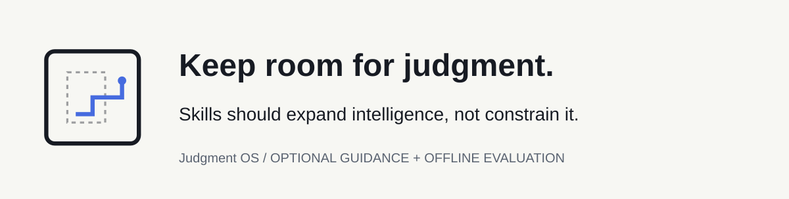
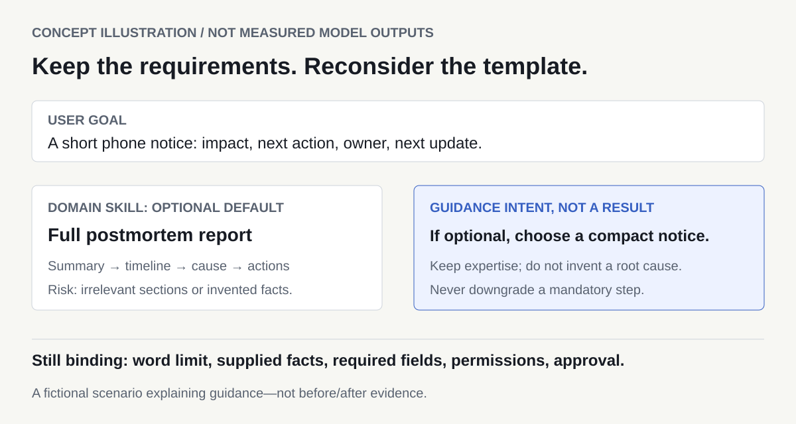

# Judgment OS

<picture>
  <source media="(max-width: 640px) and (prefers-color-scheme: dark)" srcset="docs/launch/assets/hero-mobile-dark.svg">
  <source media="(max-width: 640px)" srcset="docs/launch/assets/hero-mobile.svg">
  <source media="(prefers-color-scheme: dark)" srcset="docs/launch/assets/hero-dark.svg">
  
</picture>

**An optional meta-Skill and an offline evaluation toolkit for Agent Skills.**

*Your AI got more Skills. Does every default still fit the task?*

[](https://github.com/B-TQ/judgment-os/actions/workflows/ci.yml) [](docs/README.md#compatibility) [](LICENSE)

**[Start here](#choose-your-entry-point)** · [中文](README.zh-CN.md) · [Download v0.7](https://github.com/B-TQ/judgment-os/releases/tag/v0.7) · [Documentation](docs/README.md) · [Discuss](https://github.com/B-TQ/judgment-os/discussions)

Judgment Preserver asks an agent to adapt genuinely optional defaults while keeping binding requirements. The toolkit lets you compare what that guidance changes. Both are experimental; the full Skill has not established a general advantage over a one-sentence reminder.

## When the default is not the task

**Concept illustration — not measured model outputs.**

You need a short incident notice for people reading on a phone. A domain Skill suggests a full postmortem template. Its sections may be useful later, but are they the right delivery format now?

<picture>
  <source media="(max-width: 640px)" srcset="docs/launch/assets/skill-fit-mobile.svg">
  
</picture>

- **Goal:** a mobile-friendly notice with impact, next action, owner and next update.
- **Optional default:** an executive summary, timeline, root cause and action-item report.
- **Room for judgment:** choose a compact notice if the template really is optional; do not invent a root cause to fill a section.
- **Still binding:** the user's word limit, supplied facts, required fields, permissions and any mandatory approval.

The Skill offers natural-language guidance, not a policy engine. This illustration shows the research question, not an observed improvement. [Boundaries and when to skip it](docs/USAGE_DECISION.md).

## Choose your entry point

Download and extract [v0.7](https://github.com/B-TQ/judgment-os/releases/tag/v0.7), or clone the current documentation and source:

```sh
git clone https://github.com/B-TQ/judgment-os.git
cd judgment-os
```

Python 3.11+; no pip install. Use `python3` if that is your interpreter name.

### Use Judgment Preserver

**For:** Codex users investigating recurring use of poorly fitting optional templates. It adds explicit task-fit guidance, not new permissions or guaranteed better reasoning.

From this toolkit directory, replace `../your-project` with an **existing target project**, then preview and install:

```sh
python judgment.py skill install --project "../your-project" --dry-run
python judgment.py skill install --project "../your-project"
```

In a supporting Codex host opened on that target project, explicitly invoke `$judgment-preserver` with your task. Existing Skills are never overwritten; no global settings change. Start with clear requirements or [the shorter reminder](examples/minimal-reminder.txt) when that is enough. [Fit, installation and safe removal →](docs/USAGE_DECISION.md)

### Evaluate Your Agent Skills

**For:** developers who want frozen A/B/C/D comparisons, declared-property checks and separate review phases.

```sh
python judgment.py doctor
python judgment.py demo --out runs/first-demo
```

This prepares **8 empty slots**, checks two authored fixtures, and makes **zero model calls**. It creates no model answers or scores. Choose a fresh directory when repeating. Windows shortcut: double-click [TRY_DEMO.cmd](TRY_DEMO.cmd); on any supported OS, `python scripts/try_demo.py` runs the offline walkthrough. [Prepare your own study →](docs/QUICKSTART.md#prepare-your-own-study)

## How it works

| Layer | What it does | What it does not do |
| --- | --- | --- |
| Optional Skill | Encourages task-specific choices within binding requirements | Enforce instruction priority or guarantee creativity |
| Evaluation toolkit | Freeze inputs → collect genuine outputs → check → re-key review → report | Fabricate answers, silently reroll failures or prove all behavior from text |

The four conditions share the same binding requirements: **A** task only; **B** domain Skill; **C** B + full Judgment Preserver; **D** B + one-sentence reminder.

<details>
<summary>Implemented architecture and feature scope</summary>


- JSON/CSV/fixed-text, heading, line and whitespace-word checks.
- Frozen cases, input/output hashes, seeded preparation and explicit failed/missing states.
- Dry-run-first Codex collection or genuine external answer import with declared provenance.
- Re-keyed review packets, hash-bound imports, reviewer disagreement and explicit phase selection.
- Guarded project-local Skill installation and removal.

[Implementation audit](docs/launch/AUDIT.md) · [Architecture and non-goals](docs/architecture.md) · [CLI](docs/CLI.md)

</details>

## Demo: check an answer offline

The bundled incorrect fixture counts a cancelled order; the correct result is `{"total":11,"count":2}`.

```sh
python judgment.py check --case Q01 --answer examples/quickstart/correct.json
python judgment.py check --case Q01 --answer examples/quickstart/incorrect.json
```

Expected exits: **0** for the correct fixture, **1** for the intentional failure. These are authored software fixtures, not before/after model generations. [Demo image and explanation](docs/launch/DEMO.md) · [Full quickstart](docs/QUICKSTART.md)

## Evidence and limitations

The full meta-Skill **has not established a general advantage over a one-sentence reminder**. In the eight-case v0.6 follow-up, C–D was **1 win / 7 ties / 0 losses**. The only win came from D exceeding a word limit by one word. The adoption threshold was not met, so the full Skill stays optional.

The initial model review had incidental exposure to other-chat summaries. The original phase was retained; a corrective projectless review on unchanged answers reached the same pairwise result. Phases remain separate. This is small-sample, model-only evidence, not independent human validation or proof of equivalence.

Passing software checks does not prove model improvement. Raw private answers and review maps are excluded, so the complete historical model judgments cannot be recomputed from public source alone. [Evidence and replication limits](docs/launch/EVIDENCE.md) · [Detailed results / 中文](docs/FOLLOWUP_V06_RESULTS.md) · [Protocol](docs/STUDY_PROTOCOL_V06.md)

## Compatibility

| Environment | Verified scope |
| --- | --- |
| Windows / Linux, Python 3.11 / 3.14 | Offline checks in the actual CI matrix |
| Codex | Managed project-local files, adapter tests and a recorded native study; live calls probe required CLI flags |
| Claude Code / other hosts | No verified native integration; genuine externally generated answers can be imported |

Live collection requires Codex CLI, Git, an explicit model, live/cost flags and user authorization. A read-only sandbox is not privacy isolation. Pattern redaction is incomplete; inspect exports before sharing. File presence does not prove Skill activation. No automatic policy resolver or host-integrated orchestrator is implemented.

## Documentation and contribution

[Find the right guide](docs/README.md) · [Contribute EN / 中文](CONTRIBUTING.md) · [Report a bug or compatibility result](https://github.com/B-TQ/judgment-os/issues/new/choose) · [Ask a question](https://github.com/B-TQ/judgment-os/discussions/categories/q-a) · [Report a vulnerability privately](SECURITY.md)

Useful contributions include a fictional minimal repro, a counterexample, clearer bilingual instructions or a verified compatibility report. [Roadmap](docs/ROADMAP.md) · [Manual community drafts](docs/launch/COMMUNITY_POSTS.md) · [Changelog](CHANGELOG.md) · [MIT](LICENSE)

## FAQ

**Is this an operating system?** No. v0.7 is a source-checkout toolkit plus optional prompt-level guidance.

**Should I add it to every task?** No. Skip exact or routine tasks without meaningful discretion. A short reminder may be enough.

**How do I remove it?** Preview with `python judgment.py skill uninstall --project "../your-project" --dry-run`, then remove `--dry-run` for an unchanged managed install. Changed or added files block removal. [Details](docs/CLI.md#managed-skill-installation).

**Do I need an API key?** No for offline use. Genuine model collection is a separate, explicitly authorized step.

**What if installation says “already exists”?** Do not overwrite the target or fabricate a receipt. Inspect its existing Skill and choose another project for a disposable trial.

**Are similar tools available?** Yes: [SkillsBench](https://github.com/benchflow-ai/skillsbench) and [Skill Eval Harness](https://github.com/adewale/skill-eval-harness). We do not claim unique evaluation mechanics or superiority. [Context](docs/launch/POSITIONING.md).
