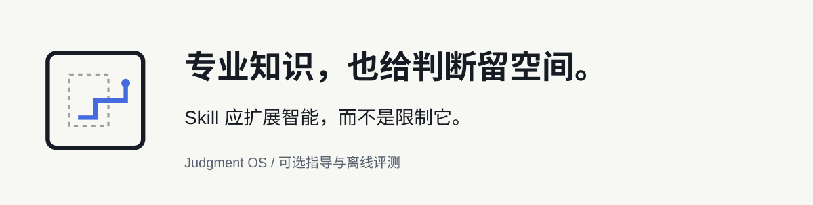
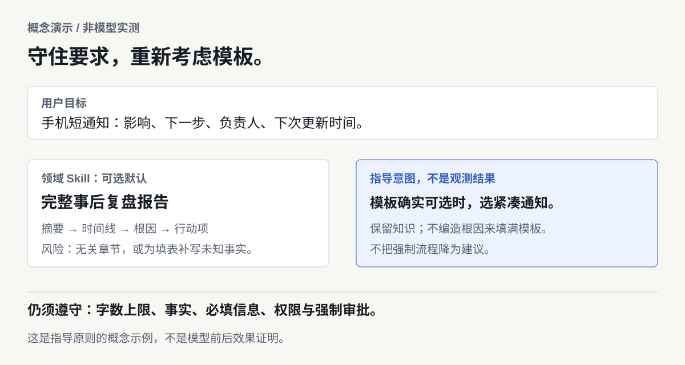
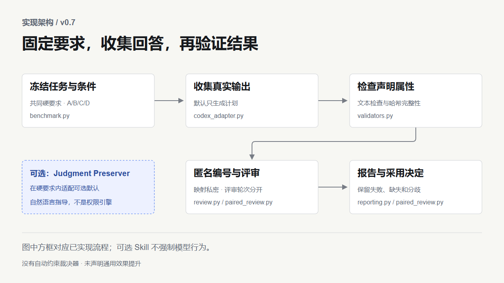

# Judgment OS

<picture>
  <source media="(max-width: 640px) and (prefers-color-scheme: dark)" srcset="docs/launch/assets/hero.zh-CN-mobile-dark.svg">
  <source media="(max-width: 640px)" srcset="docs/launch/assets/hero.zh-CN-mobile.svg">
  <source media="(prefers-color-scheme: dark)" srcset="docs/launch/assets/hero.zh-CN-dark.svg">
  
</picture>

**一个可选的元 Skill，和一套用于检验 Skill 效果的离线工具。**

*AI 装了更多 Skill，里面的默认做法还适合眼前的任务吗？*

[](https://github.com/B-TQ/judgment-os/actions/workflows/ci.yml) [](docs/README.md#compatibility) [](LICENSE)

**[从这里开始](#选择你的入口)** · [English](README.md) · [下载 v0.7](https://github.com/B-TQ/judgment-os/releases/tag/v0.7) · [文档导航](docs/README.md) · [参与讨论](https://github.com/B-TQ/judgment-os/discussions)

Judgment Preserver 提醒 Agent 在硬性要求内，适配真正可选的默认做法；评测工具则帮助比较这段指导实际改变了什么。两者仍处于实验阶段，完整 Skill 尚未证明普遍优于一句提醒。

## 默认做法，不一定就是这次的任务

**概念演示，不是真实模型输出或效果证明。**

你需要一份让人在手机上快速看懂的故障通知，而领域 Skill 推荐完整的事后复盘模板。那些章节之后可能有用，但适合现在这份交付吗？

<picture>
  <source media="(max-width: 640px)" srcset="docs/launch/assets/skill-fit.zh-CN-mobile.svg">
  
</picture>

- **用户目标：**简短通知，包含影响、下一步、负责人和下次更新时间。
- **可选默认：**执行摘要、时间线、根因、行动项组成的完整复盘。
- **可以判断的空间：**模板确实可选时，选择紧凑通知；不能为了填满章节编造根因。
- **仍须遵守：**用户的字数上限、已知事实、必填信息、工具权限及强制审批。

这是自然语言指导，不是自动权限引擎。图解说明研究问题，没有宣称已经观察到改善。[适用场景和边界](docs/USAGE_DECISION.md#中文)。

## 选择你的入口

下载并解压 [v0.7](https://github.com/B-TQ/judgment-os/releases/tag/v0.7)，或克隆当前源码及最新文档：

```powershell
git clone https://github.com/B-TQ/judgment-os.git
cd judgment-os
```

需要 Python 3.11+，不用 pip 安装。系统命令名为 `python3` 时相应替换。

### 试用 Judgment Preserver

**适合谁：**使用 Codex，遇到 Agent 反复套用不合适的可选模板，希望小范围尝试指导的用户。它不增加权限，也不保证推理提升。

在工具包目录执行，将 `../your-project` 换成**已有的目标项目目录**，先预览再安装：

```powershell
python judgment.py skill install --project "../your-project" --dry-run
python judgment.py skill install --project "../your-project"
```

然后在支持该发现方式的 Codex 宿主中打开目标项目，明确调用 `$judgment-preserver` 并描述任务。不覆盖已有 Skill，不改全局设置。先把要求写清楚；够用时也可以只试[一句提醒](examples/minimal-reminder.txt)。[何时使用、安装及安全卸载 →](docs/USAGE_DECISION.md#中文)

### 评测自己的 Agent Skills

**适合谁：**希望冻结 A/B/C/D 对照、检查声明属性、分开评审轮次的开发者。

```powershell
python judgment.py doctor
python judgment.py demo --out runs/first-demo
```

该流程准备 **8 个空槽位**并检查两份人工软件示例，**模型调用为零**，不生成模型回答或评分。重复运行换新目录。Windows 可双击 [TRY_DEMO.cmd](TRY_DEMO.cmd)；其他系统运行 `python scripts/try_demo.py`。[建立自己的实验 →](docs/QUICKSTART.zh-CN.md#建立自己的实验)

## 它怎样工作

| 层次 | 已提供什么 | 没有提供什么 |
| --- | --- | --- |
| 可选 Skill | 提醒在硬性要求内选择适合任务的做法 | 不强制执行指令优先级，不保证创造性 |
| 评测工具 | 冻结输入 → 收集真实回答 → 检查 → 匿名评审 → 报告 | 不编造回答、不偷偷重跑失败、不凭文本证明全部行为 |

四组拥有相同硬性要求：**A** 仅任务；**B** 加领域 Skill；**C** B＋完整核心；**D** B＋一句提醒。

<details>
<summary>展开已实现架构与功能范围</summary>



- JSON、CSV、固定文本、标题、行格式和空白分词字数检查。
- 冻结案例、输入输出哈希、固定种子、明确失败与缺失状态。
- 默认只生成计划的 Codex 收集，或附来源声明的外部真实回答导入。
- 重新编号的评审材料、绑定哈希的导入、分歧保留与显式选择轮次。
- 拒绝覆盖、保留用户修改的项目内 Skill 安装与卸载。

[功能审查](docs/launch/AUDIT.md) · [架构边界](docs/architecture.md) · [CLI](docs/CLI.md)

</details>

## 工具演示：离线检查一份回答

随附错误示例把已取消订单也算进去了；正确结果为 `{"total":11,"count":2}`。

```powershell
python judgment.py check --case Q01 --answer examples/quickstart/correct.json
python judgment.py check --case Q01 --answer examples/quickstart/incorrect.json
```

正确示例预期退出 **0**，故意错误的示例预期退出 **1**。这些是人工软件示例，不是模型使用 Skill 前后的回答。[演示图及说明](docs/launch/DEMO.md) · [完整上手](docs/QUICKSTART.zh-CN.md)

## 证据与局限

完整元 Skill **尚未证明普遍优于一句提醒**。v0.6 八题后续实验中，C–D 为 **1 胜、7 平、0 负**；唯一胜出来自 D 超出字数上限一个词。事前采用门槛没有达到，完整核心继续可选。

初始模型评审曾意外接触其他会话短摘要。原始轮次保留；之后对未改动回答做了 projectless 修正评审，成对结果相同。两轮分开报告。这仍是小样本、仅模型评审的证据，不是独立人工验证，也不证明两种方法等效。

软件测试通过不证明模型能力提升。真实私密回答与映射没有公开，因此无法只凭公开源码重算历史全部模型判断。[完整中文结果](docs/FOLLOWUP_V06_RESULTS.md) · [英文证据与复现边界](docs/launch/EVIDENCE.md) · [协议及偏差披露](docs/STUDY_PROTOCOL_V06.md)

## 兼容性

| 环境 | 验证范围 |
| --- | --- |
| Windows / Linux，Python 3.11 / 3.14 | 真实 CI 矩阵中的离线检查 |
| Codex | 项目内安装、适配器测试及既有原生研究；真实调用前检查所需 CLI 参数 |
| Claude Code／其他宿主 | 没有已验证的原生集成；可导入附来源的外部真实回答 |

真实收集需 Codex CLI、Git、明确模型、live／成本确认参数及用户授权。只读沙盒不等于隐私隔离，模式脱敏不完整，分享前须检查。文件存在不证明 Skill 激活。自动策略裁决器和宿主集成协调器均未实现。

## 文档与参与贡献

[按目标找文档](docs/README.md) · [贡献指南 EN／中文](CONTRIBUTING.md) · [Bug 或兼容性反馈](https://github.com/B-TQ/judgment-os/issues/new/choose) · [提问](https://github.com/B-TQ/judgment-os/discussions/categories/q-a) · [私密漏洞报告](SECURITY.md)

欢迎虚构数据构成的最小复现、反例、双语说明改进和有依据的兼容报告。[路线图](docs/ROADMAP.md) · [待选社区文案](docs/launch/COMMUNITY_POSTS.md) · [版本历史](CHANGELOG.md) · [MIT](LICENSE)

## 常见问题

**这是操作系统吗？** 不是。v0.7 是源码工具包，附带可选的提示词指导。

**每个任务都要启用吗？** 不需要。精确任务、适配良好的常规流程或没有取舍空间时跳过；一句提醒也可能够用。

**怎么卸载？** 先运行 `python judgment.py skill uninstall --project "../your-project" --dry-run`，确认后去掉 `--dry-run`。只有原样的托管安装可自动移除，增改文件会阻止卸载。[边界](docs/CLI.md#managed-skill-installation)。

**需要密钥吗？** 离线不需要，真实模型收集是另外的显式授权步骤。

**安装提示“已经存在”怎么办？** 不要覆盖文件或伪造回执。先检查已有 Skill，想做可撤回试用时可选另一个空项目。

**有没有类似工具？** 有：[SkillsBench](https://github.com/benchflow-ai/skillsbench) 和 [Skill Eval Harness](https://github.com/adewale/skill-eval-harness)。本项目不声称机制独有或效果更优。[相关工作](docs/launch/POSITIONING.md)。
