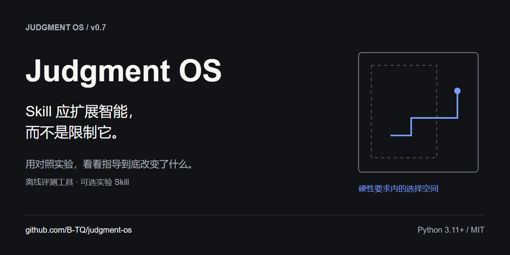
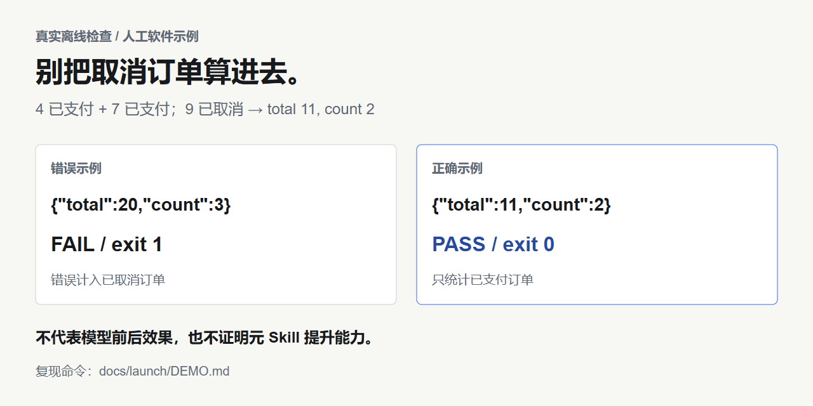

# Judgment OS

**用对照实验，看看 Skill 到底改变了什么。**

*AI 装了更多 Skill，里面的每个默认做法还适合眼前的任务吗？*

Judgment OS 是给 Agent Skill 和提示词开发者使用的离线优先评测工具。在相同要求下，对比原始任务、领域指导、实验性元 Skill 和一句提醒，保留失败记录和评审局限。

**v0.7 · Python 3.11+ · 运行时仅标准库 · MIT**

[English](README.md) · [下载 v0.7](https://github.com/B-TQ/judgment-os/releases/tag/v0.7) · [上手指南](docs/QUICKSTART.zh-CN.md) · [命令参考](docs/CLI.md) · [评测证据](docs/launch/EVIDENCE.md)



## 先看一个真实运行的检查

三笔订单：4 元已支付、7 元已支付、9 元已取消。要求仅统计已支付订单，返回 `{"total":11,"count":2}`。随附错误示例把已取消订单也算了进去，会被检查器拒绝；正确示例通过。



这是**人工编写的软件测试示例，不是模型使用 Skill 前后的回答**。它证明检查器能识别这个错误，不证明元 Skill 提升了判断力。[复现命令与退出码](docs/launch/DEMO.md)。

## 快速上手：三个离线命令

下载并解压 [Release 源码 ZIP](https://github.com/B-TQ/judgment-os/releases/tag/v0.7)，或克隆仓库：

```powershell
git clone https://github.com/B-TQ/judgment-os.git
cd judgment-os
python judgment.py doctor
python judgment.py demo --out runs/first-demo
python judgment.py check --case Q01 --answer examples/quickstart/correct.json
```

无需 pip 安装、账号或 API 密钥。系统命令名为 `python3` 时相应替换，版本需为 3.11+。演示准备 **8 个空的 A/B/C/D 实验槽位**，检查两份示例，**模型调用为零**；不会生成回答或编造评分。重复执行时换一个新输出目录，之后阅读生成的 `START_HERE.md`。

**Windows 更方便的入口：**装好 Python 后双击 [TRY_DEMO.cmd](TRY_DEMO.cmd)，自动依次执行上面三个命令，并选择新目录。其他系统运行 `python scripts/try_demo.py`。该入口只运行离线体验，不安装软件或自动调用 Skill。

查看预期失败：

```powershell
python judgment.py check --case Q01 --answer examples/quickstart/incorrect.json
```

退出码 1 是正确行为。通过确定性检查只表示声明的文本属性通过，不代表整体质量或行为都符合要求。

## 为什么要比较指导方式？

某个 Skill 推荐的模板或流程，可能不适合某个具体任务。这是需要检验的现象，不能直接推导成“Skill 普遍使 AI 退化”。再加一段长提示词，也可能没有额外收益。

工具负责冻结共同要求、收集真实输出、检查声明属性、匿名重新编号评审材料，并保留失败与分歧。可选的 **Judgment Preserver** 则用自然语言提醒 Agent：遵守硬性要求，只在确实可选的默认做法上适配任务。它不是能自动裁定指令权限的引擎。

| 组别 | 指导内容 |
| --- | --- |
| A | 只有任务 |
| B | 任务＋领域 Skill |
| C | B＋完整 Judgment Preserver |
| D | B＋一句任务适配提醒 |

## v0.7 已提供什么

- JSON、CSV、固定文本、标题、行格式和空白分词字数的确定性检查。
- 冻结案例、共同硬门槛、提示词哈希和固定种子的实验准备。
- 默认只生成计划的 Codex 收集器，以及附来源声明的外部真实回答导入。
- 重新编号的评审导出、绑定哈希的导入、显式选择评审轮次。
- 保留缺失、失败、门槛不通过及评审分歧的报告。
- 项目内可选 Skill 安装与卸载：先预览，不覆盖已有内容，修改过的文件拒绝自动卸载。


[架构边界](docs/architecture.md) · [本次功能审查](docs/launch/AUDIT.md)

## 证据实际说明了什么

完整元 Skill **尚未证明普遍优于一句提醒**。v0.6 的八题对照中，C 相对 D 为 **1 胜、7 平、0 负**；唯一胜出来自 D 超出字数上限一个词。没有达到事前采用门槛，因此完整核心仍然可选。

初始模型评审曾意外接触其他会话的短摘要。原始评审没有删除；之后对同一批未改动回答做了 projectless 修正评审，成对结果相同。两轮分开报告。这是小样本、仅模型评审的证据，不是独立人工验证，也不能证明两种方法等效。

[完整中文结果](docs/FOLLOWUP_V06_RESULTS.md) · [英文证据与复现限制](docs/launch/EVIDENCE.md) · [原方案与偏差披露](docs/STUDY_PROTOCOL_V06.md)

## 安装、预览与卸载可选 Skill

```powershell
python judgment.py skill install --project "目标项目绝对路径" --dry-run
python judgment.py skill install --project "目标项目绝对路径"
python judgment.py skill uninstall --project "目标项目绝对路径" --dry-run
python judgment.py skill uninstall --project "目标项目绝对路径"
```

替换成已有项目目录，含空格的路径加引号。在支持的 Codex 宿主明确调用 `$judgment-preserver`。不修改全局设置，不覆盖已有 Skill；如果安装后增改文件，卸载会停止。核心正文仍为 v0.2，v0.7 是工具包版本。[命令与保护边界](docs/CLI.md#managed-skill-installation)。

## 兼容性与限制

| 环境 | 验证范围 |
| --- | --- |
| Python 3.11 / 3.14，Windows / Linux | 离线 CI 矩阵；以实际 [Actions 记录](https://github.com/B-TQ/judgment-os/actions/workflows/ci.yml)为准 |
| Codex 原生收集 | 本地文件部署及软件测试、既有原生实验；真实调用前检查所需 CLI 参数 |
| Claude Code 及其他宿主 | v0.7 没有原生适配器，也没有完成端到端兼容验证；可导入附来源的外部回答 |

真实收集需 Codex CLI、Git、明确模型名、live/成本确认参数及用户授权，可能消耗账号额度。只读沙盒不等于隐私隔离，模式脱敏也不完整；分享前仍需人工检查。文件存在不证明 Skill 已激活。自动约束分类器、签名策略解析器和宿主集成协调器均未实现。

## 参与贡献与下一步

欢迎提交虚构数据构成的最小复现、兼容性反馈和反例。下一步计划是独立人工效用评估、留出任务、跨模型复验与安装体验改进；本次发布没有完成这些研究。

```powershell
python -B -m unittest discover -s tests -v
python -B scripts/audit_skills.py .agents/skills/judgment-preserver/SKILL.md --strict-metadata
python -B judgment.py selftest --out runs/pipeline-smoke
python -B judgment.py release --check
```

[贡献指南 EN / 中文](CONTRIBUTING.md) · [安全说明 EN / 中文](SECURITY.md) · [路线图](docs/ROADMAP.md) · [双语发布材料](docs/launch/README.md) · [版本历史](CHANGELOG.md) · [发布报告](LAUNCH_REPORT.md) · [MIT 许可](LICENSE)

## 常见问题

**这是操作系统或 Agent 框架吗？** 不是。名字表达研究方向，v0.7 实际是 Python 源码工具包，附带一个可选指导 Skill。

**能让 AI 更聪明吗？** 尚未证实。应在你的任务上对照验证，一句提醒也可能够用。

**有没有类似项目？** 有。[SkillsBench](https://github.com/benchflow-ai/skillsbench) 与 [Skill Eval Harness](https://github.com/adewale/skill-eval-harness) 都研究 Skill 评测。这里不声称机制独有或效果更优。[定位与相关工作](docs/launch/POSITIONING.md)。

**仅靠公开源码能重算历史结论吗？** 可以复现实验准备和软件检查。历史原始回答、私密评审映射与账号追踪没有公开，不能仅靠这次源码发布独立重算全部模型评分。
